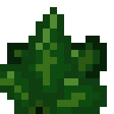

 

# [FurryBoHe](https://github.com/Furrybohe/furrybohe)

*A Minecraft mod for creating fursuit and multi-player fursuit maker.*

English · [简体中文](README.zh-CN.md)

[Quick Start](#quick-start) · [Contribute](#contribute) · [Documentation](#documentation) · [License](#license)

## Quick Start

## Contribute
Please read the [CONTRIBUTE](CONTRIBUTE.md) file for more information.

## Documentation

## License
We use [Apache License Version 2.0](LICENSE).

