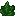

 

# [兽薄荷](https://github.com/Furrybohe/furrybohe)

*一个Minecraft模组用于制作兽装和多人兽装制作.*

[English](README.md) · 简体中文

[快速开始](#-快速开始) · [贡献](#-贡献) · [文档](#-文档) · [许可证](#-许可证)

## 快速开始

## 贡献
请阅读 [贡献](CONTRIBUTE.zh-CN.md) 文件以获取更多信息。

## 文档

## 许可证
我们使用 [Apache License Version 2.0](LICENSE).

